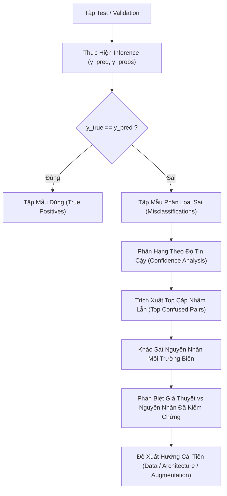

# Kế Hoạch Đánh Giá Mô Hình CNN (Evaluation Plan)
## Dự Án: Phân Loại Rác Thải Nhựa Môi Trường Biển (TrashCan 1.0 — Instance)

- **Mã công việc:** S1-EVAL (Sprint 1)
- **Tác giả:** Nhóm Đánh giá & Tối ưu hóa (Evaluation & Optimization)
- **Người phối hợp:** Phan Hải Yến (S1-ARCH / Leader), Hoàng Bách (S1-CNN / Training), Hùng (S1-DATA / Preprocessing), Ngọc Nguyên (S1-DEMO / Inference)
- **Trạng thái:** Hoàn thiện — Sẵn sàng bàn giao cho Sprint 2
- **Tài liệu tham chiếu:** [problem_statement.md](file:///e:/TEMP/Desktop/Desktop/ocean-plastic-ml-starter/docs/problem_statement.md), [dataset_report.md](file:///e:/TEMP/Desktop/Desktop/ocean-plastic-ml-starter/docs/dataset_report.md)

---

## 1. Mục Tiêu Đánh Giá (Evaluation Objectives)

Mục tiêu cốt lõi của kế hoạch đánh giá là thiết lập một quy trình chuẩn hóa, khách quan và có thể tái lập (reproducible) để đo lường năng lực của mô hình Convolutional Neural Network (CNN) trong bài toán **Phân loại ảnh rác thải môi trường dưới nước** (Underwater Plastic Waste Image Classification), sử dụng tập dữ liệu **TrashCan 1.0 — Instance**.

Các mục tiêu cụ thể bao gồm:
1. **Định lượng hóa năng lực phân loại:** Xác định bộ chỉ số đo lường hiệu năng phản ánh đúng thực tế, đặc biệt là trong bối cảnh dữ liệu dưới nước có độ mất cân bằng lớp (class imbalance) nghiêm trọng.
2. **Kiểm soát rủi ro rò rỉ dữ liệu (Data Leakage):** Thiết lập quy tắc phân chia tập dữ liệu chặt chẽ ở cấp độ video clip nhằm ngăn ngừa hiện tượng mô hình "học vẹt" bối cảnh môi trường.
3. **Chuẩn hóa giao diện dữ liệu (Interface Contract):** Định dạng thống nhất đầu vào, đầu ra giữa module huấn luyện (`train.py`), module đánh giá (`evaluate.py`), và module dự đoán (`predict.py`).
4. **Thiết kế phương pháp so sánh thực nghiệm (Experiment Comparison):** Xây dựng tiêu chí so sánh công bằng giữa mô hình CNN cơ sở (Baseline) và các giải pháp cải tiến (Data Augmentation, Regularization, Transfer Learning).
5. **Quy trình phân tích lỗi chuyên sâu (Error Analysis):** Khảo sát có hệ thống các mẫu dự đoán sai, gắn liền với các đặc thù quang học và sinh học của môi trường biển (độ đục, hấp thụ màu đỏ, rêu phong, che khuất).

---

## 2. Quy Tắc Phân Chia Dữ Liệu & Kiểm Soát Data Leakage

### 2.1. Phân biệt vai trò của các tập dữ liệu

Để đảm bảo tính khoa học và tránh thiên kiến (bias) trong quá trình phát triển mô hình, dữ liệu được phân chia thành 3 tập riêng biệt với vai trò tuyệt đối:

| Tập Dữ Liệu | Tỷ Lệ Đề Xuất | Vai Trò Chính | Điều Cấm Kỵ (Constraints) |
|---|---|---|---|
| **Training Set** | 70% | Dùng để cập nhật trọng số mạng nơ-ron thông qua lan truyền ngược (Backpropagation). | Không được chứa mẫu của Validation hay Test. |
| **Validation Set** | 15% | Giám sát hiện tượng Overfitting, tinh chỉnh siêu tham số (Hyperparameters: Learning rate, Weight decay, Dropout, Batch size), kích hoạt Early Stopping và lưu trữ Model Checkpoint tốt nhất. | Không được dùng để tính toán gradient cập nhật trọng số. |
| **Test Set** | 15% | Đánh giá độc lập cuối cùng về khả năng tổng quát hóa (Generalization) của mô hình trên dữ liệu chưa từng thấy. | **TUYỆT ĐỐI KHÔNG** dùng để tinh chỉnh siêu tham số, không dùng để chọn checkpoint mô hình (Ngăn ngừa Data Snooping). |

### 2.2. Kiểm soát Data Leakage do đặc thù video dưới nước (Thống nhất với Hùng — S1-DATA)

Tập dữ liệu **TrashCan 1.0** được trích xuất từ các đoạn video ghi hình thực tế của các thiết bị lặn điều khiển từ xa (ROV - Remotely Operated Vehicles) tại nhiều độ sâu và địa điểm khác nhau. Mỗi video bao gồm hàng trăm khung hình liên tiếp quay cùng một khu vực đáy biển.

> [!WARNING]
> **RỦI RO DATA LEAKAGE CỰC KỲ NGHIÊM TRỌNG:**
> Nếu sử dụng phương pháp chia ngẫu nhiên đơn thuần ở cấp độ khung hình (`random frame-level split`), các khung hình liền kề (cách nhau 0.1 – 0.5 giây) sẽ đồng thời xuất hiện ở cả tập Train và tập Test/Validation. Khi đó:
> - Mô hình sẽ nhận diện vật thể dựa vào màu sắc hậu cảnh (background underwater color tone), vệt sáng đèn ROV, hoặc rạn san hô cố định thay vì học đặc trưng của rác thải nhựa.
> - Kết quả Accuracy trên tập Test sẽ cao giả tạo (Over-optimistic), nhưng mô hình sẽ thất bại hoàn toàn khi kiểm thử trên một vùng biển mới.

**Quy tắc phân chia thống nhất với S1-DATA:**
1. **Video/Clip-Level Splitting:** Phân chia dữ liệu dựa trên định danh video (`video_id` hoặc chuỗi frame liên tục `sequence_id`). Toàn bộ các khung hình trích xuất từ cùng một video clip **chỉ được phép nằm trọn vẹn trong một tập duy nhất** (Train HOẶC Validation HOẶC Test).
2. **Stratified Group Split:** Nếu một số lớp hiếm chỉ xuất hiện trong ít video, sử dụng thuật toán `StratifiedGroupKFold` để vừa bảo đảm phân bố lớp cân đối giữa các tập, vừa bảo toàn tính toàn vẹn của nhóm video (Group = `video_id`).
3. **Không áp dụng Data Augmentation lên tập Validation và Test:** Mọi thao tác tăng cường dữ liệu (Flip, Rotation, Color Jitter, Turbidity Simulation) chỉ được thực hiện trên tập Training trong lúc huấn luyện.

---

## 3. Hệ Thống Chỉ Số Đánh Giá (Evaluation Metrics)

### 3.1. Phân tích toán học và ý nghĩa thực tế trong môi trường biển

#### 1. Accuracy (Độ chính xác tổng quan)
$$\text{Accuracy} = \frac{TP + TN}{TP + TN + FP + FN} = \frac{\sum_{i=1}^{C} c_{ii}}{\sum_{i=1}^{C} \sum_{j=1}^{C} c_{ij}}$$
- **Ý nghĩa:** Tỷ lệ phần trăm giữa tổng số mẫu dự đoán đúng trên toàn bộ mẫu đánh giá.
- **Hạn chế (Accuracy Paradox):** Trong bộ dữ liệu TrashCan, số lượng mẫu giữa các lớp rất chênh lệch (ví dụ: các lớp rác phổ biến như `trash_bag`, `trash_bottle` có số lượng mẫu áp đảo so với các lớp hiếm như `trash_can`, `trash_pipe`). Một mô hình ngây thơ luôn dự đoán vào lớp đa số vẫn có thể đạt Accuracy trên 80%, nhưng hoàn toàn vô dụng với các lớp rác thải còn lại.
- **Kết luận:** Accuracy chỉ dùng làm chỉ số tham khảo tổng quan (Secondary Metric), không dùng làm căn cứ quyết định mô hình tốt nhất.

#### 2. Precision (Độ chuẩn xác)
$$\text{Precision}_i = \frac{TP_i}{TP_i + FP_i}$$
- **Ý nghĩa:** Trong số tất cả các đối tượng mà mô hình dự đoán là loại rác $i$, có bao nhiêu đối tượng thực sự là loại rác $i$.
- **Tác động thực tiễn:** Precision phản ánh rủi ro **Báo động giả (False Alarm)**. Nếu áp dụng vào hệ thống robot thu gom dưới biển, Precision thấp sẽ khiến robot gắp nhầm sinh vật biển, san hô hoặc đá ngầm (do phân loại nhầm thành rác), gây tổn hại hệ sinh thái biển và tiêu tốn năng lượng của robot.

#### 3. Recall (Độ thu hồi / Nhạy)
$$\text{Recall}_i = \frac{TP_i}{TP_i + FN_i}$$
- **Ý nghĩa:** Trong số tất cả các đối tượng rác loại $i$ thực tế xuất hiện dưới biển, mô hình phát hiện đúng được bao nhiêu phần trăm.
- **Tác động thực tiễn:** Recall phản ánh rủi ro **Bỏ sót rác thải (Missed Detections)**. Nếu Recall thấp, rác thải nhựa nguy hại sẽ bị bỏ qua và tiếp tục phân rã thành vi nhựa, gây nguy hại môi trường lâu dài.

#### 4. F1-score (Điểm F1)
$$\text{F1-score}_i = 2 \times \frac{\text{Precision}_i \times \text{Recall}_i}{\text{Precision}_i + \text{Recall}_i} = \frac{2 \cdot TP_i}{2 \cdot TP_i + FP_i + FN_i}$$
- **Ý nghĩa:** Trung bình điều hòa (Harmonic Mean) giữa Precision và Recall. Chỉ số này chỉ đạt giá trị cao khi cả Precision và Recall đều đồng thời đạt mức tốt, phạt nặng trường hợp một trong hai chỉ số bị đánh đổi quá mức.

---

### 3.2. Phân biệt Macro Average, Weighted Average và Per-Class Metrics

Trong bài toán phân loại nhiều lớp ($C$ lớp):

| Phương Pháp Tính | Công Thức Toán Học | Đặc Điểm & Ý Nghĩa Phân Tích |
|---|---|---|
| **Macro Average** | $\text{Macro Metric} = \frac{1}{C} \sum_{i=1}^{C} \text{Metric}_i$ | Đánh giá bình đẳng mọi lớp, không phụ thuộc vào số lượng mẫu (Support). Nếu mô hình thất bại trên một lớp hiếm, Macro Score sẽ sụt giảm mạnh. **Phản ánh trung thực khả năng nhận diện lớp thiểu số.** |
| **Weighted Average** | $\text{Weighted Metric} = \sum_{i=1}^{C} \frac{N_i}{N_{\text{total}}} \text{Metric}_i$ | Có tính trọng số theo kích thước từng lớp ($N_i$). Kết quả phản ánh hiệu năng theo tần suất xuất hiện thực tế của dữ liệu, nhưng có thể che giấu khuyết điểm lớn ở các lớp hiếm. |
| **Per-Class Metrics** | $\text{Metric}_i \quad \forall i \in \{1, \dots, C\}$ | Báo cáo chi tiết Precision, Recall, F1 và Support cho từng lớp rác thải cụ thể. Cần thiết để kỹ sư dữ liệu và huấn luyện phát hiện chính xác lớp nào cần bổ sung dữ liệu. |

> [!IMPORTANT]
> **QUYẾT ĐỊNH CHỈ SỐ CỐT LÕI (PRIMARY METRIC):**
> Nhóm thống nhất lựa chọn **Macro F1-score** làm **Chỉ số chính (Primary Metric)** để:
> 1. Đánh giá chất lượng mô hình trên tập Validation và Test.
> 2. Thiết lập tiêu chí Early Stopping và lưu trữ Model Checkpoint tốt nhất.
> 3. Làm căn cứ so sánh giữa CNN Baseline và các phương án cải tiến trong các báo cáo thực nghiệm.

---

### 3.3. Confusion Matrix (Ma trận nhầm lẫn)

Confusion Matrix là ma trận vuông kích thước $C \times C$, trong đó phần tử $C_{ij}$ biểu thị số lượng mẫu có nhãn thực tế là lớp $i$ nhưng được mô hình dự đoán là lớp $j$.

- **Đường chéo chính ($C_{ii}$):** Các mẫu được phân loại chính xác ($TP_i$).
- **Ngoài đường chéo ($C_{ij}, i \neq j$):** Các trường hợp phân loại nhầm (Misclassifications).
- **Chuẩn hóa theo hàng (Normalized by True Class):** $\frac{C_{ij}}{\sum_k C_{ik}}$ giúp trực quan hóa tỷ lệ Recall của từng lớp và xác định rõ lớp $i$ thường bị nhầm sang lớp nào nhất.

---

## 4. Giao Diện Dữ Liệu Thống Nhất Giữa Training & Evaluation

Để đảm bảo quá trình tích hợp mượt mà giữa module huấn luyện của Hoàng Bách (`src/train.py`) và module đánh giá (`src/evaluate.py`), định dạng dữ liệu đầu ra được quy chuẩn như sau:

### 4.1. Định dạng đầu ra dự đoán (Inference Output)
Khi chạy đánh giá trên tập Validation hoặc Test, module huấn luyện/dự đoán cần cung cấp:
- `y_true`: Mảng 1D (`numpy.ndarray` hoặc `list`) kiểu nguyên hoặc chuỗi, kích thước `(N,)`, chứa nhãn thực tế của $N$ mẫu.
- `y_pred`: Mảng 1D kích thước `(N,)`, chứa nhãn dự đoán sau khi lấy `argmax`.
- `y_probs` *(Tùy chọn nhưng khuyến nghị)*: Mảng 2D kích thước `(N, C)`, chứa điểm xác suất Softmax cho từng lớp, phục vụ phân tích độ tin cậy (Confidence Analysis) và tìm lỗi phân loại.
- `class_names` / `target_names`: Danh sách chuỗi tên lớp theo đúng thứ tự index mapping: `[name_0, name_1, ..., name_{C-1}]`.

### 4.2. Định dạng lịch sử huấn luyện (Training History)
Sau quá trình huấn luyện, đối tượng lịch sử cần được xuất dưới dạng Dictionary (hoặc file `history.json`):
```python
history = {
    "epoch": [1, 2, ..., E],
    "loss": [0.85, 0.62, ..., 0.15],
    "accuracy": [0.65, 0.76, ..., 0.94],
    "val_loss": [0.90, 0.68, ..., 0.28],
    "val_accuracy": [0.62, 0.73, ..., 0.89],
    "val_macro_f1": [0.55, 0.69, ..., 0.86]  # Khuyến nghị tính qua từng epoch
}
```

### 4.3. Quy cách lưu trữ Model Checkpoint & Metadata
Mỗi lần huấn luyện mô hình cần lưu lại thư mục thực nghiệm tương ứng trong `models/checkpoints/<experiment_id>/` gồm:
1. `best_model.keras` (hoặc `.pt` / `.h5`): Trọng số mô hình có `val_macro_f1` cao nhất.
2. `config.json`: Cấu hình siêu tham số và môi trường thực nghiệm.
3. `metrics_summary.json`: Kết quả đánh giá chi tiết trên tập Validation và Test.

---

## 5. Thiết Kế So Sánh Thực Nghiệm (Experiment Comparison)

### 5.1. Mô hình CNN Baseline cần đánh giá
- **Kiến trúc cơ sở:** CNN Convolutional Baseline 3-4 khối Conv2D (Conv2D -> ReLU -> BatchNorm -> MaxPooling2D -> Dropout -> Dense -> Softmax).
- **Mục tiêu baseline:** Thiết lập ngưỡng hiệu năng tối thiểu có thể chấp nhận được trên bộ dữ liệu ảnh rác thải đáy biển trước khi áp dụng các kỹ thuật phức tạp.

### 5.2. Đề xuất kịch bản so sánh thực nghiệm (Sprint 1 & Sprint 2)

| Kịch Bản | Tên Thực Nghiệm | Phương Án Kỹ Thuật | Giả Thuyết Kỳ Vọng (Hypothesis) |
|---|---|---|---|
| **EXP-001** | **CNN Baseline** | Kiến trúc CNN tiêu chuẩn, không Data Augmentation, resize ảnh 224x224, Adam lr=1e-3. | Thiết lập mốc hiệu năng cơ sở (Benchmark). Dễ bị overfitting do dữ liệu ảnh dưới nước biến thiên phức tạp. |
| **EXP-002** | **CNN + Underwater Augmentation** | Áp dụng tăng cường dữ liệu đặc thù: biến đổi cân bằng màu (Color Jitter mô phỏng nước biển), mô phỏng độ đục (Blur), xoay/lật góc quay ROV ngẫu nhiên. | Giảm thiểu Overfitting, cải thiện khả năng thích nghi với các điều kiện nước đục, tăng Macro F1 ít nhất 3-5%. |
| **EXP-003** *(Dự kiến Sprint 2)* | **CNN + Class-Weighting** | Áp dụng trọng số tổn thất (Focal Loss hoặc Weighted CrossEntropy) bù đắp mất cân bằng lớp. | Tăng mạnh Recall và F1-score trên các lớp rác hiếm gặp. |
| **EXP-004** *(Dự kiến Sprint 2)* | **Transfer Learning (MobileNetV2 / ResNet50)** | Sử dụng backbone tiền huấn luyện trên ImageNet, fine-tune trên dữ liệu TrashCan. | Nâng cao toàn diện độ chính xác và khả năng trích xuất đặc trưng bậc cao. |

### 5.3. Các yếu tố cần giữ cố định (Controlled Variables)
Để việc so sánh có giá trị khoa học, các yếu tố sau **bắt buộc phải giữ nguyên** giữa các lần chạy:
- Cùng một bộ phân chia Train / Validation / Test (Split Video-level cố định).
- Cùng Random Seed (`seed = 42`) cho việc khởi tạo trọng số và nạp dữ liệu.
- Cùng độ phân giải ảnh đầu vào (Ví dụ: `224x224x3`).
- Cùng hàm mất mát cơ bản (Cross-Entropy Loss), trừ trường hợp thử nghiệm Loss mới.
- Cùng quy tắc đánh giá và tính chỉ số qua `src/evaluate.py`.

### 5.4. Mẫu Bảng So Sánh Thực Nghiệm (Comparison Table Template)

```markdown
| Exp ID | Tên Mô Hình / Kỹ Thuật | Train Loss | Val Loss | Test Loss | Test Accuracy | Test Macro Prec | Test Macro Rec | Test Macro F1 (Chính) | Số Lượng Tham Số | Ghi Chú |
|---|---|---|---|---|---|---|---|---|---|---|
| EXP-001 | CNN Baseline | - | - | - | - | - | - | - | ~2.5M | Baseline chuẩn |
| EXP-002 | CNN + Underwater Aug | - | - | - | - | - | - | - | ~2.5M | Thêm Color & Turbidity Aug |
| EXP-003 | CNN + Class Weighting | - | - | - | - | - | - | - | ~2.5M | Phạt nặng lớp thiểu số |
```

> [!NOTE]
> **Nguyên tắc trong Sprint 1:** Chỉ thiết lập phương pháp luận, công cụ tính toán và bảng mẫu. **TUYỆT ĐỐI KHÔNG** điền số liệu giả định khi chưa có kết quả huấn luyện thực tế từ Hoàng Bách.

---

## 6. Quy Trình Phân Tích Lỗi (Error Analysis Design)

Phân tích lỗi là bước quan trọng nhất để hiểu rõ cơ chế hoạt động của mô hình và định hướng cải tiến trong các chu kỳ tiếp theo, thay vì thử nghiệm mò mẫm.

### 6.1. Quy trình 5 bước xác định và mổ xẻ mẫu dự đoán sai



1. **Bước 1: Trích xuất toàn bộ mẫu dự đoán sai:** Lọc tất cả các chỉ số $k$ sao cho $y_{\text{true}}[k] \neq y_{\text{pred}}[k]$.
2. **Bước 2: Phân loại theo độ tin cậy (Confidence Stratification):**
   - **High-Confidence Errors ($P_{\text{pred}} > 0.8$ nhưng sai):** Mô hình rất tự tin nhưng đoán sai hoàn toàn. Đây là các lỗi nghiêm trọng nhất, thường do đặc trưng bị học lệch (Spurious Correlation) hoặc gán nhãn sai (Label Noise) trong dữ liệu gốc.
   - **Low-Confidence Errors ($P_{\text{pred}} \approx \frac{1}{C}$ hoặc chênh lệch giữa Top-1 và Top-2 rất nhỏ):** Mô hình phân vân giữa các lớp có hình thái tương đồng hoặc ảnh quá mờ.
3. **Bước 3: Lập danh sách Top Cặp Nhầm Lẫn (Top Confused Pairs):** Trích xuất từ Confusion Matrix các cặp $(Class_A \rightarrow Class_B)$ có tần suất nhầm lẫn lớn nhất.
4. **Bước 4: Đối chiếu đặc thù quang học & môi trường nước biển:**
   - **Mất màu sắc theo độ sâu (Color Attenuation):** Nước biển hấp thụ dải quang phổ đỏ cực mạnh, chỉ truyền ánh sáng xanh lam và xanh lục. Vật thể rác có màu đỏ hoặc cam sẽ bị chuyển thành xám/đen dưới đáy biển sâu.
   - **Độ đục và hạt lơ lửng (Turbidity & Marine Snow):** Cát bụi, phù sa và hạt hữu cơ trôi nổi phản xạ ánh sáng đèn flash ROV (Backscatter), tạo thành các vệt đốm trắng che mờ rác thải.
   - **Ánh sáng loang lổ (Caustic Effects):** Hiện tượng khúc xạ ánh sáng mặt trời qua sóng biển nông tạo ra các dải hoa văn sáng tối di động làm vỡ đường nét của vật thể.
   - **Biến dạng cơ học & Sinh vật bám (Deformation & Biofouling):** Chai nhựa bị ép bẹp do áp suất nước; túi nilon bị vò nát quấn quanh đá; rong rêu, hà biển bám kín bề mặt rác làm thay đổi hoàn toàn vân bề mặt (texture).
   - **Kích thước vật thể nhỏ (Small Objects):** Rác thải chiếm dưới $5\%$ diện tích khung hình dễ bị mất đặc trưng qua các lớp Pooling của mạng CNN.
5. **Bước 5: Phân biệt Giả thuyết (Hypothesis) và Nguyên nhân đã kiểm chứng (Verified Cause):**
   - *Giả thuyết:* "Mô hình nhầm túi nilon thành lưới đánh cá vì có nhiều nếp gấp tương tự nhau." (Cần kiểm chứng bằng Grad-CAM hoặc thử nghiệm với ảnh phóng to).
   - *Nguyên nhân kiểm chứng:* Ảnh nhãn gốc bị sai lệch (Label Noise được con người kiểm tra lại) hoặc kích thước vật thể dưới $16 \times 16$ pixel.

---

### 6.2. Mẫu Bảng Tổng Hợp Lỗi & Hướng Cải Tiến (Error Catalog Template)

| ID Mẫu | Nhãn Thực Tế | Nhãn Dự Đoán | Độ Tin Cậy ($P$) | Hiện Tượng Quan Sát Trên Ảnh | Giả Thuyết Nguyên Nhân | Trạng Thái Kiểm Chứng | Hướng Khắc Phục Đề Xuất |
|---|---|---|---|---|---|---|---|
| ERR-001 | `trash_bag` | `trash_net` | 0.87 | Túi nilon bị rách tua rua, quấn quanh rạn đá dưới ánh sáng xanh. | Các dải rách tạo vân sọc tương tự mắt lưới đánh cá; mất kênh màu đỏ. | Giả thuyết hợp lý | Bổ sung tăng cường mô phỏng quang phổ xanh; thêm dữ liệu túi rách. |
| ERR-002 | `trash_bottle` | `rov` | 0.45 | Chai nhựa nhỏ ở góc xa, nền tối, có ánh kim loại phản chiếu. | Mô hình bắt vào điểm phản quang của đèn ROV trên vỏ chai. | Đã kiểm chứng (Grad-CAM) | Crop tập trung vào vật thể (Bounding Box) trước khi đưa vào CNN. |

### 6.3. Quy cách lưu trữ hình ảnh lỗi (Visual Artifacts)
- Mọi mẫu dự đoán sai được xuất thành hình ảnh ghép (Subplots) lưu tại `results/misclassified_samples.png`.
- Mỗi ảnh hiển thị:
  - Khung ảnh RGB gốc.
  - Tiêu đề màu đỏ: `True: <Tên_Lớp_Thực> | Pred: <Tên_Lớp_Đoán> (Conf: XX.X%)`.
  - Lưu kèm file metadata `results/error_analysis.json` để phục vụ thảo luận trong cuộc họp Sprint Review.

---

## 7. Kế Hoạch Phối Hợp & Nghiệm Thu (Handover & RACI Matrix)

| Thành Viên | Phụ Trách Issue | Vai Trò (RACI) | Nhiệm Vụ Phối Hợp Cụ Thể |
|---|---|---|---|
| **Hoàng An** (Tác giả) | S1-EVAL | **Accountable / Responsible** | Xây dựng `src/evaluate.py`, `notebooks/04_evaluation.ipynb`, `docs/evaluation_plan.md`; kiểm thử smoke test. |
| **Hoàng Bách** | S1-CNN | **Consulted / Informed** | Đảm bảo định dạng đầu ra của `train.py` tương thích với `evaluate.py`; tiếp nhận bộ chỉ số và learning curves. |
| **Phan Hải Yến** | S1-ARCH (Lead) | **Accountable / Approver** | Review tài liệu kế hoạch đánh giá; phê duyệt Primary Metric và kịch bản so sánh thực nghiệm. |
| **Hùng** | S1-DATA | **Consulted** | Thống nhất quy tắc chia tập dữ liệu Video-Level để tránh rò rỉ dữ liệu; cung cấp danh sách class mapping chính thức. |
| **Ngọc Nguyên** | S1-DEMO | **Informed** | Tiếp nhận ngưỡng tự tin (Confidence Threshold) và cấu trúc Classification Report để tích hợp vào ứng dụng demo. |

---

## 8. Danh Sách Kiểm Tra Nghiệm Thu (Acceptance Checklist)

- [x] Kế hoạch đánh giá mô tả rõ vai trò 3 tập Train/Val/Test và nguyên tắc cấm dùng Test set để tuning.
- [x] Có giải pháp cụ thể kiểm soát Data Leakage do video frames dưới nước phối hợp với Hùng.
- [x] Giải thích đầy đủ bản chất toán học và ý nghĩa của Accuracy, Precision, Recall, F1-score.
- [x] Phân biệt rõ Macro Average vs Weighted Average, xác định Macro F1 làm Primary Metric.
- [x] Thiết kế hợp đồng giao diện dữ liệu (Interface Contract) giữa Training và Evaluation.
- [x] Xây dựng mẫu bảng so sánh thực nghiệm và các yếu tố kiểm soát cố định.
- [x] Thiết lập quy trình phân tích lỗi 5 bước gắn liền với quang học biển và mẫu danh mục lỗi.
- [x] Cam kết không sử dụng dữ liệu giả định/chưa qua thực nghiệm để đưa ra kết luận.
